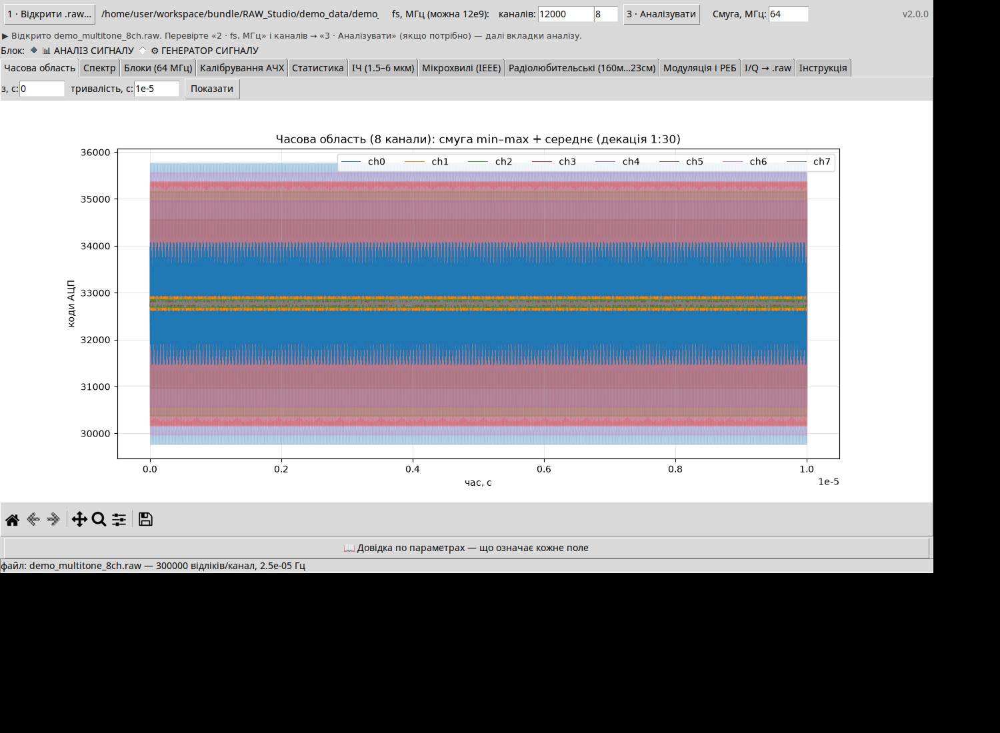
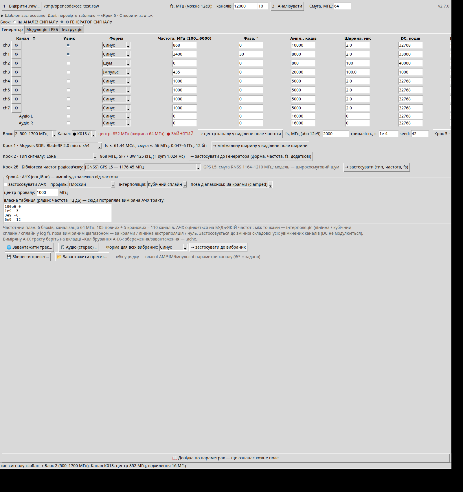
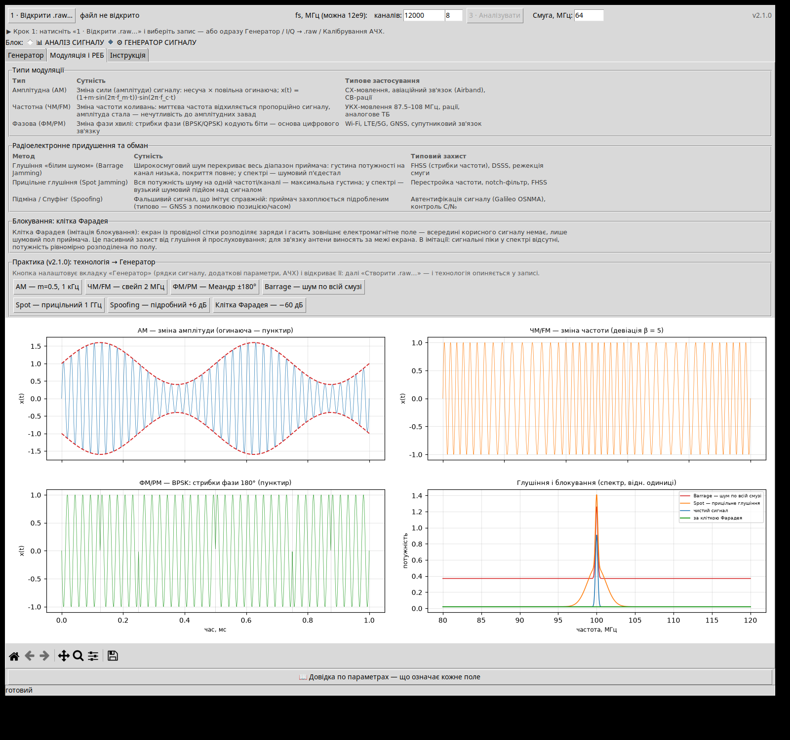

# 
## НОВЕ в 6.2.0 — Водоспад у реальному часі · PDF-звіти з GUI · RTL-TCP

- **🌊 Водоспад (реальний час)** — живий спектр: внутрішній генератор (усі види бібліотеки) або RTL-TCP; кільцевий буфер 200 кадрів (нові зверху), палітри viridis/inferno/magma/plasma, діапазон дБ, інтервал кадру; **📄 PDF-звіт** поточного водоспаду;
- **📄 PDF-звіти прямо з GUI** — новий збирач `gui_pdf_report` (титул + нотатки + зображення, кирилиця DejaVu) — кнопка у водоспаді, бібліотечна функція для інших діалогів;
- **🔌 RTL-TCP без залежностей** — `rtl_tcp_cmds` (протокол 1+4 Б, big-endian) + `rtl_tcp_read` (8-бітні I/Q → комплексні відліки);
- selftest «Водоспад+PDF v6.2.0: PASS» (5 перевірок), E2E v6.2.0: NO_ERROR.

## НОВЕ в 6.1.0 — Завади та перехоплення керування: пакети · реактивна · PER · пеленг · RC-декодер

- **Завада (пакети)** — новий вид у Генераторі: barrage-шум з огинаючою періоду/тривалості (скважність);
- **⏱ Профіль завади** — сцени + покриття, вікна тиші + реактивна модель (виявлення/опромінення/економія);
- **📊 PER-криві** — BER/PER vs J/S через mod_ber (BPSK…LoRa SF12);
- **📻 Багаточастотний план** — смуги → канали приладу за пріоритетом;
- **📈 J/S-калькулятор** — крива J/S(дистанція) + радіус придушення;
- **🛡 Стійкість лінка** — стрибки/LBT/скважність з запису → тактика + рейтинг (CW/чирп/шум/пакети);
- **🎮 RC-декодер** — пакети запису + фрейми SBUS/iBUS/CRSF/MSP → канали, телеметрія CRSF (батарея, GPS), failsafe;
- **🌀 Хоп-послідовність** — цикл патерну + прогноз каналів;
- **📶 Якість лінка** — LQ %, втрати, RSSI-таймлайн;
- **🧭 Пеленгатор** — амплітудний RDF (4 канали → азимут, впевненість);
- **⚡ Енергодетектор** — скважність/темп → клас сигналу по каналах;
- **🛰 Детектор GPS-спуфінгу** — ознаки підроблення в записі (розкид, стрибок, гладкість);
- **CLI**: `--jamprofile "0:30:0.5;30:60:0.1,60"`, `--percurve "BPSK,512"`, `--rcscan "file.raw,1,1,0"`;
- selftest «Завади+Керування v6.1.0: PASS», E2E v6.1.0: NO_ERROR.

## НОВЕ в 6.0.0 — Інструментарій: порівняння · журнал · панорама · імпорт IQ · SCPI TX · Монте-Карло · CLI

- **⚖ Порівняння записів .raw** (панель інструментів Генератора): два записи → спектри перших каналів, топ-8 піків з Δ придушення (макс у вікні ±3 біни), вердикт «середнє Δ, придушено (Δ≥10 дБ)»;
- **🗂 Журнал сесій** (SQLite `~/.raw_studio_history.db`): усі модулі пишуть події; діалог з переглядом/експортом CSV/очищенням;
- **🗺 Панорама запису**: спектри каналів у блоках FREQ_BLOCKS, склеєні по частотах 100М…6Г, піки з підписами на Canvas;
- **📂 Імпорт IQ → растр FPV**: u2-запис → FM-демодуляція (Гільберт → миттєва частота → люмінансність) → превʼю растру PAL/NTSC;
- **🎛 SCPI TX / пресети приладів**: пресети команд зйомки траси (R&S, Siglent, Rigol — бінарний блок, Keysight, TinySA); керування TX-генератором (IDN, CW частота/рівень, вихід ON/OFF); авто-скан за розкладом з журналом піків у CSV; підклад з траси → амплітуди шумових каналів (dBFS = пік − ref);
- **Рецепти SDR**: «💾 Зберегти парк» / «📂 Завантажити парк» (JSON) + «📄 PDF-звіт» з таблиці рецептів;
- **🎲 Монте-Карло follow-me** (лабораторія плавлення): 10⁴ розигришів p_виявлення/перестроювання → гістограма + довірчий коридор P5/P50/P95;
- **🧠 Розпізнавання сигнатур піків** (профіль завади): ширина −3 дБ → сигнатура (FPV / Wi-Fi / LoRa / ГНСС) → «→ Крок 3» ставить тип першому увімкненому каналу;
- **🌗 Тема**: перемикач dark/light (запам'ятовується у `~/.raw_studio.json`, застосовується після перезапуску);
- **CLI**: `--recipes CVBS --park "HackRF One,PlutoSky R2" [--pa --dist --dj --ant --freq --out CSV]` та `--melt "BPSK,915,20,40,6,0.125,5000,64"` — таблиця PRR по дистанціях;
- selftest «Інструментарій v6.0.0: PASS», E2E v6.0.0: NO_ERROR.

## НОВЕ в 5.9.0 — Рецепти SDR (парк платформ)

- новий розділ програми: кнопка **«📋 Рецепти SDR (парк)…»** у Кроці 2в Генератора;
- ціль (13 AI-цілей) + опційна частота-замінник, дистанції завади/розкриття, ПП/підсилювач/антена;
- парк платформ — чекбокси всіх 19 моделей (за замовчуванням 14 TX-платформ, приймальні вимкнені);
- вердикти: **OK** (повне покриття) / **СМУГА** (звужено до 0.4·fs) / **ПОЗА** (частота поза платою) / **ПРИЙОМ** (без TX); сортування за радіусом придушення;
- подвійний клік по рядку ставить модель у Крок 1; «💾 Експорт CSV…» (utf-8-sig, «;»);
- рушій `recipe_plan` (v5.9.0) на базі `ai_recommend_jam`: J/S, потрібна потужність, макс. дальність, радіус придушення при паспортному TX;
- selftest «Рецепти v5.9.0: PASS» (точна математика p_req/d_max/0.4·fs), E2E v5.9.0: NO_ERROR.

RAW Studio

**Аналізатор записів АЦП (`.raw`) та генератор радіосигналів — в одному вікні.**

Чистий Python 3 — Tkinter + NumPy + Matplotlib. Без зовнішніх сервісів, телеметрії та облікових записів: усі обчислення виконуються локально.

- **Версія:** 5.8.0
НОВЕ в 5.8.0: блок «🔌 Спектроаналізатор (SCPI)…» (Крок 2в) — інтеграція з приладами по SCPI/TCP (R&S FSV/FSW, Siglent SSA/SHA/SVA, Rigol RSA/DSA, Keysight CXA/N90x0, TinySA; порт 5025 — дефолт, 5555 для TinySA; VISA не потрібен): підключення з розбором *IDN? (виробник/модель/серійник/ПЗ), налаштування сканування (центр, span, RBW, опорний рівень), зйомка траси (:TRAC? TRACE1 — ASCII або бінарний блок int16), топ-8 піків з частотами і рівнями на графіку Canvas, «→ Піки у профіль завади» (далі працюють профіль завади з аналізу і FPV-скан «з аналізу .raw»), експорт траси в CSV (частота, дБм). У самотесті — TCP-емулятор SCPI-приладу (реальний сокет), тож цикл «підключення → sweep → траса → піки» перевіряється без заліза.
НОВЕ в 5.7.2: авто-підбір fs для всієї програми — у Генератора (Крок 1) поле «fs, МГц» доповнено режимом «Авто за сигналом»: потрібна частота дискретизації рахується з увімкнених каналів плану (Найквіст 2·f_max + запас 2 МГц або 1/мін. тривалість імпульсу, якщо більша) і округлюється вгору до стандартного ряду АЦП (64/125/250/500/1000/2000/2500/4000/5000/6000/8000/12000 МГц); розрахунок виконується автоматично на кнопках генерації «⚡ Згенерувати .raw» і сценарію (Крок 4б), підказка «авто» показує активний режим. Це єдине поле fs у програмі — його значення автоматично використовують сценарії, IQ-конверсія, звіти PDF і аналіз-інструменти; режим «Вручну» (дефолт) зберігає колишню поведінку. Аналогічний режим у модулі FPV-відео (v5.7.1).
НОВЕ в 5.7.1: у модулі «FPV-відео» частота дискретизації fs тепер підбирається автоматично по типу сигналу: режим «Авто за сигналом» (дефолт) обирає перше значення стандартного ряду АЦП (64/125/250/500/1000/2000/2500/4000/5000/6000/8000/12000 МГц), що перекриває Найквіста 2·(f + девіація) + запас 2 МГц на фронти синхроімпульсів відео — для несучих 5.8 ГГц це 12 ГГц (пряма оцифровка), для випробувальних 16 МГц — 64 МГц; можна задати щабель ряду вручну. Понад ряд — повідомлення «не перекривається».
НОВЕ в 5.7.0: модуль «📺 FPV-відео: перехоплення та інжекція» (кнопка в рядку інструментів Генератора) — робота з аналоговим радіо-відеопотоком БпЛА/FPV: ① скан діапазонів 5.8 ГГц (Band A/B/E/F, Raceband — по 8 каналів) за піками спектра останнього .raw або вручну, таблиця каналів з рівнями і статусом «ВІДЕО/шум», оцінка якості прийому за SNR (FM-поріг 12 дБ, насичення 26 дБ); ② лінк-бюджет інжектора в цей канал: EIRP = p_rx(відео) + запас + FSPL(d) − G_ант, вердикт FM-захоплення приймача (запас ≥ 6 дБ — приймач показує інжектоване відео, 0…6 — рвана картинка), «⤵ Підставити ПП у Крок 2в»; ③ синтез іншого відео в той самий канал у .raw: тестові кадри (кольорові смуги, градієнт, смуги-застереження, PNG/JPG) → розгортка PAL/NTSC (синхроімпульс + активна частина рядка) → частотна модуляція на несучу каналу (девіація, кадри, амплітуда; fs/каналів — поля діалога, ліміт 40 млн відліків) → запис .raw (u2, DC 32768, інтерлівінг каналів) + контрольне зворотне розкладання растру (Гільберт → миттєва частота → люмінансність) з превʼю «джерело ↔ відновлений растр». Значення — типові орієнтири; стендовий інструмент для планування і навчання, апаратурою не керує.
НОВЕ в 5.6.0: «Лабораторія плавлення» (кнопка 🔥 у Кроці 2в) — оцінка придушення пакетного каналу БпЛА завадою по дальності: PRR-модель (BER модема BPSK/QPSK/16QAM/LoRa SF7–SF12 → Eb/N0 з урахуванням відношення BW/Rb → ймовірність прийому пакета; зона плавлення = дальність, де PRR < порогу, з графіком на Canvas); follow-me-симулятор (частка хопів, які завада встигає накрити: p_виявлення × (t_хоп − t_перестроювання)/t_хоп; виграш дрона від сітки 10·lg N дБ); вікно failsafe (p спрацювання = p_блокування у степені к-сті хопів у таймауті, поріг надійності 95%); протокол-пульсація (мінімальний імпульс під протокол: преамбула LoRa sym·2^SF/BW, пакет, постійна; економія середньої потужності в дБ); кнопка «🎯 Профіль завади з аналізу…» у рядку інструментів — топ-8 піків спектра останнього .raw, розкид смуги, PRI, з переходом у лабораторію плавлення. Значення — типові орієнтири; стендовий інструмент, апаратурою не керує.
НОВЕ в 5.5.0: у модулі «ОВ-дрон (оптика + контролер)» — ШІ-підбір повного тракту завади (ранжування пар «SDR (ПП) + антена (G, втрати КСВ)» під потрібну EIRP на частоті впливу з урахуванням кабелю; «→ Крок 2в» переносить ПП/підсилювач/антену; окремо — потрібна потужність лазерного інжектора для оптичного каналу) та симулятор завади по вибраному модему (рівень світла інжектора на фотодіоді по дистанціях 0.5–200 м, статуси без впливу / зрив CDR / засліплення, J/S проти сигналу дрона з урахуванням затухання волокна за λ і пройденої дистанції, граничні дистанції впливу, дистанція резонансного впливу на контролер, графік на Canvas). Значення — типові орієнтири; стендовий інструмент, апаратурою не керує.

НОВЕ в 5.4.1: виправлення — кнопка «→ застосувати якісну заваду до таблиці каналів» (Крок 2в) тепер розповсюджує форму й частоту завади на ВСІ увімкнені рядки таблиці (раніше — лише на перший); смуга/fs лишаються спільними; статус показує кількість і перелік оновлених каналів.

НОВЕ в 5.4.0: модуль «ОВ-дрон (оптика + контролер)» — вплив на тракт оптоволоконного керування БпЛА: довідник 9 класів ОВ-модемів (міні-TOSA 155 Мбіт/с, SFP SX/LX, 20 км, DFB 40 км, BiDi WDM одноволоконний, SFP+ 10G LR, PON 1490/1310, аналогове FM-відео); засліплення фотоприймача (пляма, геометричні втрати, P на фотодіоді, статуси: без впливу / зрив CDR / засліплення) і потрібна потужність інжектора на дистанцію; резонансний ЕМ-вплив на кварц МК / опорний генератор CDR (потрібні E, В/м → EIRP, дБм); «→ ПП, дБм у Крок 2в»; експорт CSV довідника. Значення — типові орієнтири для планування РЕБ; для конкретного виробу потрібні вимірювання.

НОВЕ в 5.3.0: 3D-графіки у PDF-звіті — «📄 Звіт у PDF…» автоматично додає три нові сторінки: 3D-спектрограма останнього відкритого/згенерованого .raw (час × частота × рівень), «Завада vs ціль (3D)» (якщо порівняння виконувалося — спектр цілі, хребет завади і зона перекриття), 3D-мапа покриття (запас над порогом кут × дальність за EIRP з Кроку 2в). Модульні рендерери render_spec3d_png / render_vs3d_png / render_map3d_png доступні і для своїх скриптів; build_pdf_report приймає входи-словники spec3d/map3d/vs3d.

НОВЕ в 5.2.0: 3D-візуалізація — «⛰ 3D-побудова» у діалозі спектрограми та «⛰ 3D-спектрограма…» у новому рядку аналізу (час × частота × рівень як поверхня з обертанням), «⚔ Завада vs ціль (3D)…» (спектр цілі з .raw і модель завади двома хребтами, зона перекриття підсвічена; % перекриття смуги цілі і J/S у статусі), «⛰ 3D-мапа покриття» (запас над порогом кут × дальність). Аналіз: «⚖ Порівняння A/B…» — два .raw до/після завади: виразність піка цілі A → B і метрика придушення (дБ); «⏱ PRI-аналіз…» — період слідування, тривалість і джиттер імпульсів з огинаючої + кнопка «→ у Крок 3»; «🔊 Демодуляція аудіо…» — ЧМ/АМ у WAV (девіація, декімація). РЕБ: мобільні фази — «швидкість, м/с» (доплер f·(1+v/c)) і «дальність, км» (ослаблення ×1/d) у фазах «Кроку 4б»; «🎯 Мінімальна потужність ПП» — зворотний лінк-бюджет (J/S + поріг + FSPL − G_ант + 10lg(BWз/BWс)) з «→ у поле ПП, дБм»; готові сценарії (FPV/дрон-лінк 5.8 ГГц, захист конвою 433 МГц з рухом, GNSS-спуфінг по фазах, обхід дір плану) списком + «⤵ Застосувати». Звіти: «🗂 Батч-аналіз теки…» — пік/ширина/рівень по кожному .raw, автоматичний CSV batch_report.csv і графік піків; «💾/📂 Профіль сесії…» (.rprofile) — канали, fs/тривалість/seed, Крок 2в (ПП/підсилювач/поріг), Крок 3 (RGPO/VGPO/захищені/рівень) і фази сценарію одним файлом. CLI: raw_studio.py --batch DIR OUT.csv [fs nch ch].

НОВЕ в 5.1.0: метрика покриття плану — кнопка «📏 Метрика покриття» рахує % діапазону плану, вкритого завадами, знаходить діри (непокриті піддіапазони) і J/S по каналах (20lg(ампл) − рівень сигналу; рівень задається новим полем «рівень сигналу, дБ» у Кроці 3). Мапа покриття — кнопка «🗺 Мапа покриття (FSPL)» у Кроці 2в будує полярну мапу дальності завади за лінк-бюджетом EIRP + G(кут) − FSPL ≥ поріг приймача (FSPL = 92.45 + 20lg(f_ГГц) + 20lg(d_км)), з урахуванням ширини пелюстки і заднього променя антени. Звіт PDF — кнопка «📄 Звіт у PDF…» зберігає звіт: титулка, таблиця каналів плану, метрика покриття, спектр каналів і мапа покриття (шрифт DejaVu — кирилиця). Таймлайн-сценарії — «Крок 4б · Сценарій»: фази на шкалі часу (тривалість, с + активні каналы ch), збереження/завантаження .scenario.json, візуальна шкала фаз і генерація .raw (фази послідовно, хвилі активних каналів підсумовуються в моно-канал). CLI/batch: raw_studio.py --scenario scenario.json out.raw [fs] — пакетна генерація сценарію без GUI. Форми «Завада RGPO» і «Завада VGPO» тепер у списку «Форма» Генератора.

НОВЕ в 5.0.0: обман радарних приймачів — нові форми «Завада RGPO» (затягування по дальності: радіоімпульсна репліка цілі з наростаючою затримкою 2v/c; після макс. затримки репліка зникає; у «Кроці 3»: швидкість відриву м/с, макс. затримка мкс; період/тривалість імпульсу — спільні поля) і «Завада VGPO» (затягування по швидкості: доплерівський зсув репліки росте лінійно до максимуму, потім репліка зникає; макс. доплер кГц, час затягування с). Захищені частоти: нове поле «захищені частоти, МГц» (кома; «а-б» = діапазон, голе число — ±2.5 МГц) — «Пік → завада», «Піки → канали плану» і ШІ-застосування відмовляють для піків/завад у захищених смугах (свої канали не глушаться), генерація .raw попереджає про увімкнені канали у захищених смугах.

НОВЕ в 4.9.0: багатоцільова завада з одного запису — вікно «Завада з IQ» показує таблицю топ-N піків (до 8: частота, смуга, тип завади, рівень); кнопка «Піки → канали плану» розкладає вибрані піки по увімкнених каналах Генератора (рядок із частотою всередині смуги піка отримує той пік, решта — по черзі; ширина шумової завади береться за найширшим піком). Спектрально-формований шум: після «Аналізувати» поруч із .iq створюється профіль .spectrum.json; прапорець «шум за профілем спектра» — jam_noise формується точно за записаним профілем (мінімум потужності поза зайнятою смугою цілі).

НОВЕ в 4.8.0: конвертер I/Q читає .rtsa (формат RTSA-File-Format-4): кнопка «🔓 Розпакувати .rtsa → .iq + .iq.xml» створює пару файлів поруч із записом і заповнює fs/центр з .iq.xml; «Крок 3» з .rtsa розпаковує автоматично. Підтримані нестиснуті пакети (mCompression=0; F32/F32N, S16/S16N, U8/U16/U32/S32). Стиснуті пакети (mCompression≥1 — закритий алгоритм Aaronia) дають чітку відмову з підказкою: RSTAFileTool repair -compress=0 запис.rtsa вихід.rtsa.

НОВЕ в 4.7.0: вкладку Генератора зроблено скрользяною — вертикальна смуга прокрутки праворуч і колесо миші при наведенні: Крок 2в (таблиця якісної завади і текст КСВ), кнопка «Крок 5 · Створити .raw…» та всі рядки під нею тепер досяжні навіть на невеликих екранах, де вміст не вміщується за висотою.

ВИПРАВЛЕНО в 4.6.1: конвертер I/Q пояснює проблеми замість загадкової помилки — при виборі .rtsa (стиснутий нативний формат RTSA-Suite) одразу показує попередження з інструкцією (експортуйте Raw IQ .iq з File Source), «Крок 3» відхиляє .rtsa ДО читання файлу, а повідомлення про числа перелічує саме ті поля, що порожні або невірні (fs I/Q, центр, …).

НОВЕ в 4.6.0: рядок частотного плану перенесено з-під кнопки «Створити .raw…» між кроками — тепер він стоїть перед «Крок 4 · АЧХ», поруч із поясненням інтерполяції АЧХ; під кнопкою лишились лише рядки дій.

НОВЕ в 4.5.0: інтерфейс Генератора перебудовано послідовно: 1 Модель SDR → 2 Тип сигналу (2б Бібліотека частот, 2в Якісна завада) → 3 Додаткові параметри → 4 АЧХ → 5 «Створити .raw…» внизу; усунуто перекриття Кроку 3 і Кроку 4.

НОВЕ в 4.4.0: кнопка «📷 Зберегти діаграму у PNG» над діаграмою у вкладці «Спектр» — окремий PNG лише з діаграмою спрямованості (150 dpi), з шкалою КСВ або без неї (за перемикачем).

НОВЕ в 4.4.0: перемикач «приховати шкалу КСВ» у «Кроці 2в» — ховає кольорову дугу і рядок втрат на діаграмі спрямованості; PNG-звіт враховує стан перемикача.

НОВЕ в 4.4.0: на полярній діаграмі спрямованості — накладена шкала КСВ-втрат: кольорова дуга по діапазону антени (0°→180° = f_min→f_max, темніше = більші втрати) і рядок точних значень «МГц (КСВ) → втрати дБ» під діаграмою; шкала автоматично потрапляє у PNG-звіт.

НОВЕ в 4.4.0: поля θ₃ (ширина пелюстки) і заднього проміню для власної антени в «Кроці 2в»; діаграма спрямованості додається у PNG-звіт спектрограми поруч зі спектром; статус після ШІ-застосування попереджає, якщо несуча вище Найквіста.

Виправлення в 4.4.0: діалоги генерації («Генерувати з аліасингом?», «Розмір файла…», збереження .raw) тепер завжди з'являються поверх головного вікна (parent=self) і не губляться за ним.

НОВЕ в 4.4.0 — Діаграма спрямованості антени у вкладці «Спектр»: полярна діаграма в азимутальній площині для антени, вибраної в «Кроці 2в» (модель головної пелюстки −12·(θ/θ₃)² до рівня заднього/бічного проміння, підсилення — з поля «дБі»); оновлюється при зміні типу/підсилення антени. Реліз піднято до 4.4.0.
НОВЕ в 3.24.0 — Тракт передачі в радіусі придушення: поле зовнішнього підсилювача (дБ) біля «ПП, дБм», блок антени (тип із автозаповненням підсилення дБі й робочого діапазону, редаговувана таблиця КСВ на різних частотах); радіус придушення рахується як ПП + підсилювач + антена − втрати КСВ, рядок «Потужність ПП для J/S» підсвічується зеленим, коли тракт покриває потребу, і червоним — коли ні; поза діапазоном антени — окреме попередження.
НОВЕ в 3.23.0 — Очікуваний радіус придушення та контроль потужності SDR: у таблиці якісної завади показано максимальну вихідну потужність обраної моделі SDR (паспортні значення) і радіус, у межах якого ця плата придушує ціль; якщо потужності плати не вистачає — таблиця показує попередження з потрібними дБм, фактичними дБм і реальним радіусом. Приймальні платформи (RTL-SDR, KrakenSDR, KiwiSDR, Aaronia) позначено як такі, що не передають.
НОВЕ в 3.22.0 — Таблиця якісної завади в Генераторі (Крок 2в): замість «сирого» набору параметрів — розрахунок параметрів якісної завади за Типом сигналу (Крок 2) та Моделлю SDR (Крок 1): рекомендований тип завади, частота і смуга, потрібне J/S, потужність ПП, дальність завади, мінімальна ширина імпульса за fs плати й обґрунтування; враховуються ПП/дальність/дистанція. Кнопка «→ застосувати» підставляє форму, частоту, смугу завади і fs прямо в таблицю каналів.
НОВЕ в 3.21.0 — Офсет приймача у пресетах і профілях: калібрувальний офсет (dBFS→дБм) з діалогу «Завада з IQ» тепер зберігається у пресетах генератора (`.rspreset`) та у профілях АЧХ (`.achx`) разом із темою — після завантаження пресету чи профілю офсет відновлюється автоматично; старі файли без офсета читаються як раніше (0 дБ).
НОВЕ в 3.20.0 — Калібрувальний офсет у заваді з IQ: нове поле «Офсет, дБ» у діалозі — перерахунок рівня сигналу dBFS → дБм з урахуванням реального коефіцієнта приймача/підсилювача (рівень = dBFS + офсет, діапазон −100…100 дБ); потрібна потужність для J/S рахується вже від відкаліброваного рівня, офсет показується у результаті аналізу та у статусі застосування.
НОВЕ в 3.19.0 — Завада з IQ: у розділі «IQ → raw» нова кнопка «⚡ Завада з IQ… — сигнал і спектр»: діалог аналізує IQ-запис (Welch-спектр, вікно Ганна), знаходить пік, вимірює зайняту смугу (поріг −20 дБ від піка), шумову підлогу, динамічний діапазон і рівень сигналу (dBFS, адаптивно до шкали даних); тип завади обирається за шириною (до 50 кГц — CW, 0.05–1.5 МГц — ЛЧМ з девіацією за шириною і періодом, понад 1.5 МГц — шум зі смугою 1.5 × ширина), потужність — під заданий J/S. Кнопка «Пік → завада» застосовує параметри до всіх увімкнених каналів генератора.
НОВЕ в 3.18.0 — Експорт спектрограми у PNG: у діалозі спектрограми з'явилася кнопка «💾 Експорт PNG…» — побудована спектрограма зберігається у файл; ім'я пропонується автоматично з імені .raw («файл_spectrogram.png»), роздільність 150 dpi, кольори фігури беруться з активної теми.
НОВЕ в 3.17.0 — Спектрограма з .raw: новий модуль запуску і перегляду — кнопка «📊 Спектрограма .raw…» у головному вікні відкриває діалог, де обирається згенерований .raw (за замовчуванням — останній створений генератором), частота дискретизації, канал, вікно NFFT (256–4096) і перекриття (0–75%); розрахунок STFT (вікно Ганна, рівні в дБ відн. піка) малюється на екрані програми зі шкалами «Час, мс» / «Частота, МГц» і кольоровою шкалою. Шлях щойно згенерованого .raw запам'ятовується — спектрограма будється одним натисканням.
НОВЕ в 3.16.0 — Тема «Windows XP»: шоста тема оформлення у стилі Luna — світло-бежева палітра вікон (#ECE9D8), синій акцент виділення (#316AC5), об'ємні кромки кнопок і вкладок; варіант «Windows XP» у перемикачі тем, зберігається між запусками, у пресетах (.rspreset) і профілях АЧХ (.achx), бере участь у циклі «Наступна тема» трея.
НОВЕ в 3.15.0 — Живе авто-перемикання теми, іконка в треї, тема у профілях .achx: режим «Авто (год)» перевіряє системний годинник щохвилини і перемикає «День»/«Техно» на льоту, без перезапуску; додано іконку програми в системному треї з меню «Показати / Наступна тема / Вихід» (опційно: потрібен пакет pystray — без нього програма працює як раніше); тема тепер зберігається і в профілях АЧХ — службовий рядок «# theme:» у .achx, завантаження профілю автоматично повертає збережену тему (старі профілі читаються як раніше).
НОВЕ в 3.14.0 — AMOLED і авто-тема: четверта тема «AMOLED» (чистий чорний, неоновий акцент) у перемикачі, режим «Авто (год)» обирає день/ніч за системним годинником при старті, тема зберігається в шапці пресетів (.rspreset) і відновлюється при завантаженні.
НОВЕ в 3.13.0 — Три теми і ретро-графіки: перемикач «Техно/Класична/День» (світло-сіра денна палітра), акцент на кнопці генерації «Крок 5 · Створити .raw…», при зміні теми наявні графіки перефарбовуються і перемальовуються одразу.
НОВЕ в 3.12.0 — Нічний режим і теми: акцентні кнопки на головних діях (Генерувати/Екстрагувати/Застосувати), темні графіки matplotlib у кольорах палітри, перемикач «🎨 Техно-тема» у тулбарі (техно/класична; вибір зберігається у ~/.raw_studio_theme).
НОВЕ в 3.11.0 — Техно-дизайн GUI: темна технологічна палітра, об'ємні 3D-кнопки/картки/вкладки (тема clam з керуванням світлом і тінню граней), градієнтний банер з об'ємною табличкою версії та консольний статус-рядок.
НОВЕ в 3.10.0 — Блокові завади BladeRF: 5 цілей ШІ-модуля (LoRa 450–490, LTE 1900, відеолінки 2200–2360 та 3300–3800, радіотелеметрія 2020–2100), 6 пресетів «Завада блок …» (шум 20–40 МГц, fs_hint 56 МГц) і група «ТЛМ 2020–2100 (2 канали BladeRF)».
НОВЕ в 3.9.0 — Завада з піка зображення: кнопка «Пік → завада» ставить у генератор тип (CW до 50 кГц / ЛЧМ 0.05–1.5 МГц / шум понад 1.5 МГц, смуга 1.5×ширина), частоту піка та потрібний рівень для J/S +15 дБ.
- **Автор:** Vaskov Yaroslav, CIT PROGRAM LLC
- **Платформи:** Windows / Linux / macOS



## 📊 Блок «Аналіз сигналу»

| Вкладка | Можливості |
|---|---|
| **Часова область** | Осцилограми каналів, зум, навігація по запису |
| **Спектр** | FFT запису, лог/лінійні шкали |
| **Блоки (64 МГц)** | Частотний план 100 МГц…6 ГГц: 6 блоків, 110 каналів по 64 МГц |
| **Калібрування АЧХ** | Вимірювання АЧХ тракту за калібрувальним записом, збереження/завантаження профілів `.achx`, компенсація тракту, перенесення профілю в Генератор |
| **Статистика** | Мінімум/максимум/середнє/RMS по каналах |
| **I/Q → .raw** | Конвертер I/Q записів у формат `.raw` |
| **Інструкція** | Вбудований довідник із клікабельним змістом |

## 📚 Вбудовані довідкові модулі

- **ІЧ (1.5–6 мкм)** — піддіапазони інфрачервоного спектру з довжинами хвиль.
- **Мікрохвилі (IEEE)** — діапазони UHF…V/W з частотами та довжинами хвиль.
- **Радіолюбительські (160 м…23 см)** — діапазони IARU Region 1 з позначками FT8.
- **Модуляція і РЕБ** — теорія (АМ/ЧМ/ФМ, barrage/spot/spoofing, клітка Фарадея) **+ практичні кнопки** в Генераторі.

## ⚙ Блок «Генератор сигналу»



- **10 каналів**: 8 радіоканалів + 2 аудіо («Аудіо L» / «Аудіо R»).
- **Генерація за всіма вибраними каналами**: кількість каналів запису автоматично розширюється до останнього позначеного рядка таблиці.
- **«Форма для всіх вибраних»**: обрана форма застосовується до всіх позначених каналів; у кожному рядку можна лишити власну форму.
- **Власні додаткові параметри каналу** (кнопка «⚙» у рядку): АМ, ЧМ/ЛЧМ, період/тривалість/фронти імпульсу — окремо для кожного каналу; «⚙*» позначає задані, решта каналів бере спільні.
- **Пресети конфігурації** («💾 Зберегти пресет…» / «📂 Завантажити пресет…»): усі рядки, форми, параметри, власні дод. параметри, fs, тривалість і АЧХ — у файл `.rspreset` (JSON).
- **Форми сигналу**: синус, меандр, трикутник, імпульс (радіоімпульс із фронтом/спадом), шум.
- **Додаткові параметри**: період слідування, тривалість імпульсу, фронти, АМ (індекс + частота), ЧМ/ЛЧМ (девіація + період).
- **АЧХ-фільтр при генерації**: пресети (плоский, спад −3 дБ/окт, смуговий, провал) або власна таблиця.
- **Бібліотека сигналів (51 запис)**: FM/ТВ, 3G/4G/5G, WiFi, GNSS (GPS / ГЛОНАСС / Galileo / BeiDou), Bluetooth FHSS, LoRa, GSM та ін.; групи каналів — одним натисканням.
- **Контроль Найквіста** та частотного плану 100 МГц…6 ГГц.
- **Демо-запис** у пакеті для Windows: `demo_data/demo_multitone_8ch.raw`.

### РЕБ-практика: «технологія → Генератор»



Сім кнопок налаштовують Генератор під демонстрацію технології прямо в записі:

| Кнопка | Що генерується |
|---|---|
| **АМ** | Синус 200 МГц, індекс модуляції 0.5, частота 1 кГц |
| **ЧМ/FM** | Синус 200 МГц із частотним свейпом 2 МГц |
| **ФМ/PM** | Меандр 150 МГц — стрибки фази ±180° (BPSK-подібна форма) |
| **Barrage** | Білий шум по всій смузі запису (загороджувальна завада) |
| **Spot** | Шум, обмежений АЧХ-фільтром 990–1010 МГц (прицільна завада на 1 ГГц) |
| **Spoofing** | «Справжній» сигнал 1575.42 МГц + підробний 1575.52 МГц, удвічі потужніший |
| **Клітка Фарадея** | Сигнал 300 МГц + АЧХ −60 дБ по всій смузі — запис майже порожній |

### Аудіо-стерео в записі

- **«🎵 Аудіо (стерео)…»** — WAV (8/16/32 біт PCM) з диска; MP3/FLAC/OGG/M4A — автоматично через `ffmpeg`.
- Ліва доріжка → **«Аудіо L»**, права → **«Аудіо R»**; тривалість запису = тривалість треку; fs запису автоматично → `max(4×sr, 1 МГц)`, щоб аудіо повністю вмістилося.
- **«🌐 Завантажити трек…»** — завантаження аудіо за URL: пряме посилання (mp3/wav/ogg, до 200 МБ) або YouTube (через `yt-dlp` + `ffmpeg`).

## 🖥 Інтерфейс

- **Два блоки з перемикачем** «📊 Аналіз сигналу / ⚙ Генератор сигналу»; після застосування типу сигналу або запису бібліотеки — автоперемикання на Генератор.
- **Вбудована інструкція** в обох блоках із клікабельним змістом; довідка по кожному полю («📖 Довідка по параметрах»).

## 📁 Формати та CLI

- `.raw` — 16-бітні відліки (uint16, little-endian), чергування каналів.
- `.achx` — профілі АЧХ із метаданими; `.plan` — плани частот; `.rspreset` — пресети Генератора (JSON).
- CLI-режими: `--version`, `--selftest`, `--headless`, `--preview`, `--calgen`.

```bash
python raw_studio.py                # графічний інтерфейс
python raw_studio.py --selftest     # самоперевірка
python raw_studio.py --version
```

## 📦 Вимоги та встановлення

```bash
pip install numpy matplotlib    # обов'язково
pip install yt-dlp              # опційно — завантаження з YouTube
# ffmpeg — опційно (MP3/FLAC/OGG, YouTube)
python raw_studio.py
```

Докладніше про збірку — у [README_BUILD.md](README_BUILD.md).

## 🗜 Історія версій

| Версія | Нове |
|---|---|
| **2.5.0** | Власні АМ/ЧМ/імпульсні параметри для кожного каналу + пресети конфігурації `.rspreset` |
| **2.6.0** | Блок і Канал частотного плану підставляються автоматично за несучою застосованого типу сигналу / групи / запису бібліотеки |
| **2.7.0** | Зайняті канали плану позначаються «●» у селекторі «Канал» і червоним «● ЗАЙНЯТИЙ» біля центра; Блок/Канал підставляються також під час ручного введення частоти в таблицю |
| **2.8.0** | Новий тип сигналу «Комплекс GNSS L1 (E1+G1+B1+L1)»: Galileo E1 BOC(1,1) + ГЛОНАСС G1 FDMA + BeiDou B1I + GPS L1 C/A в одному каналі (форма «GNSS L1») |
| **2.9.0** | Розподіл комплексу по каналах: ШПС-форми «GPS L1» / «Galileo E1» / «ГЛОНАСС G1» / «BeiDou B1», чотири пресети й група «Комплекс L1 по каналах (E1/G1/B1/L1)»; групи авто-увімкають рядки |
| **3.0.0** | Тип сигналу Mesh (Xingkai XK-F358): пресети UHF/L/S/C/MIIT — модель TD-COFDM-пачок з FHSS; форма «Mesh COFDM»; група «Mesh XK-F358 2T2R» (TX1+TX2) |
| **3.1.0** | Mesh XK-F358: додано діапазон S2 3200–3400 МГц (пресет «Mesh XK-F358 S2», центр 3300 МГц, fs 8000 МГц) |
| **3.2.0** | Mesh: 6 пресетів піддіапазонів S 1.6–2.9 ГГц (центри 1700…2800 МГц) + перемикач модуляції «модуляція Mesh (QAM)»: адаптивна BPSK…1024QAM або фіксована (реальні QAM-сітки); поле — у «Кроці 3» і у вікні ⚙ канала |
| **3.3.0** | TGTX5050A — бортова завадозахищена ГНСС-антенна (16-елементна CRPA, L1 1559–1610 МГц): пресети RF1/RF2 (прийом комплексу GNSS L1) + групи «TGTX5050A CRPA (RF1+RF2)» і «TGTX5050A + завада (3 канали)»; типи завад «Завада CW» / «Завада (шум)» (barrage, смуга 20 МГц) / «Завада (чирп)» (ЛЧМ ±5 МГц) для тесту адаптивних нулів; поле «ширина смуги завади, МГц» у «Кроці 3» і ⚙ |
| **3.4.0** | Спуфінг: форма «Spoofing GPS» — підробний GPS L1 C/A (BPSK(1)) зі зміщенням несучої («зміщення несучої спуфера, Гц») і дрейфом («дрейф зміщення (плаваюча несуча), Гц/с»; за замовчуванням +500 Гц / +10 Гц/с); пресети «зміщення +500 Гц» і «плаваюча (+10 Гц/с)»; групи «Спуфер + реальний GPS (2 канали)» і «TGTX5050A + спуфер (3 канали)» |
| **3.5.0** | Рівномірний розподіл: тип сигналу з «Кроку 2» і бібліотека застосовуються до ВСІХ увімкнених каналів (однакова форма, несуча, fs, додаткові параметри); авто-DC (32768 — середина коду) і авто-Підсилення від типу сигналу (PAPR: Шум/Mesh COFDM/Завада (шум) → 0.5) та частоти (< 1 ГГц ×1.0, 1–3 ГГц ×0.9, ≥ 3 ГГц ×0.8) — у шаблонах, групах і «Формі для всіх вибраних» |
| **3.6.0** | Після генерації в статусі — пік (± кодів від DC), PAPR (дБ) і фактичний запас до кліпування по кожному увімкненому каналу; «DC від частоти» для однополярного «Імпульса» (без радіоімпульсних extras): DC = 32768 − ампл·підс/2 — центрування 0…ампл |
| **3.7.0** | ШІ-модуль підбору завади: база знань 8 цілей (GPS L1, ГЛОНАСС G1, Galileo E1, BeiDou B1, вся L1, Mesh COFDM, Wi-Fi 2.4, FPV 5.8) + лінк-бюджет (ФСМ, J/S, поправка шуму −10lg(BW/BWs), потрібна потужність ПП, максимальна дистанція); тип завади від класу сигналу і потужності ПП (CW < 17 дБм, чирп 17–27, шум ≥ 27; OFDM — тільки шум; для ГНСС — опційний спуфінг); обмеження смуги 0.4·fs моделі SDR; кнопка «🤖 ШІ-підбір завади…» з поясненням рішення і застосуванням до каналів |
| **3.8.0** | Спектр із зображення: оцифрування PNG/JPEG скріншота аналізатора чи графіка — авто-рамка графіка, авто-колір траси (домінантний відтінок; для ч/б — яскравісний режим), калібрування осей МГц/дБ, крива на полотні, пошук піків (рівень, S/N, ширина −3 дБ), прив'язка піків до блоків/каналів плану, передача найсильнішого піка в ШІ-підбір завади |
| **3.8.1** | Спектр із зображення — скріншоти SDR: поле графіка у відсотках (лів/прав/верх/низ) + кнопка «🔍 Огляд» (мініатюра з червоною рамкою вибору); яскравісний режим ігнорує насичені пікселі (кольоровий водоспад, червоні маркери, жовті підписи); вибір режиму color/lum за покриттям колонок; медіанне згладжування кривої |
| **2.4.0** | Генерація за всіма вибраними каналами + «форма для всіх вибраних» |
| **2.3.0** | Кнопка «🌐 Завантажити трек…» — аудіо за URL (пряме посилання або YouTube) |
| **2.2.0** | Аудіо-стерео: канали «Аудіо L»/«Аудіо R», WAV/MP3 через ffmpeg |
| **2.1.0** | «Модуляція і РЕБ» у Генераторі + розділ «Практика» (7 кнопок) |
| **2.0.0** | Два блоки інтерфейсу з перемикачем режимів |
| 1.7–1.8 | Вбудована інструкція, клікабельний зміст |
| 1.3–1.6 | Довідники: ІЧ, мікрохвилі IEEE, радіодіапазони, модуляція і РЕБ |

---
© Vaskov Yaroslav, CIT PROGRAM LLC

## Збірка автономного .exe (PyInstaller)

RAW Studio можна зібрати в ОДИН виконуваний файл — Python на цільовій машині не потрібен.

**Windows (цільова платформа .exe):**
1. Встановіть Python 3.10+ з python.org (відмітка «Add python.exe to PATH»).
2. `pip install numpy scipy matplotlib pillow pypdf reportlab pystray pyinstaller`
3. Розпакуйте ZIP у будь-яку теку — мають бути `raw_studio.py` і `raw_studio.spec`.
4. У цій теці: `pyinstaller raw_studio.spec`
5. Результат: `dist\RAW_Studio.exe` — автономний файл (~150–200 МБ разом із numpy/matplotlib/yt_dlp), запуск подвійним кліком.

**Linux / macOS:** той самий spec — `python3 -m PyInstaller raw_studio.spec` → `dist/RAW_Studio`.

**Примітки:**
- Перший запуск onefile-збірки повільніший (розпакування в тимчасову теку).
- Деякі антивіруси довше сканують onefile-збірки — це нормально.
- Збірка без консолі (windowed): на Windows вивід CLI-режимів (`--selftest`, `--jamprofile`, ...) у консоль не потрапляє — для CLI-роботи зберіть консольний варіант: `pyinstaller --onefile --console raw_studio.py`.
- Специфікація frozen-сумісна: самотест у зібраному файлі сам викликає себе як CLI (sys.frozen), приховані імпорти — backend_tkagg, mpl_toolkits.mplot3d, pystray (платформозалежний); діагностика збоїв рендеру/вбудовування друкуються самотестом лише при відмові.

- Іконка застосунку: `RAW_Studio.ico` у складі ZIP — spec підхоплює її автоматично, якщо вона лежить поруч із `raw_studio.py` (немає файла — збирається без іконки).

